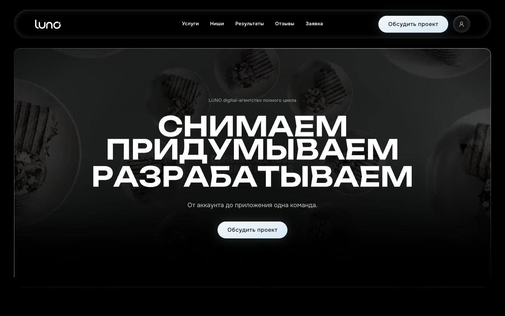
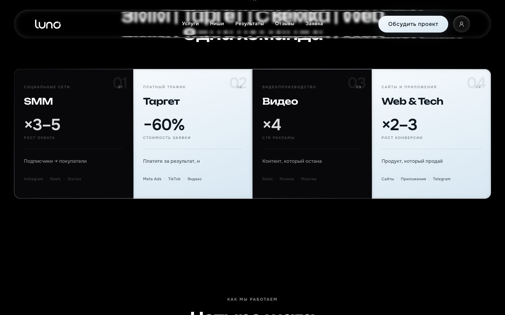
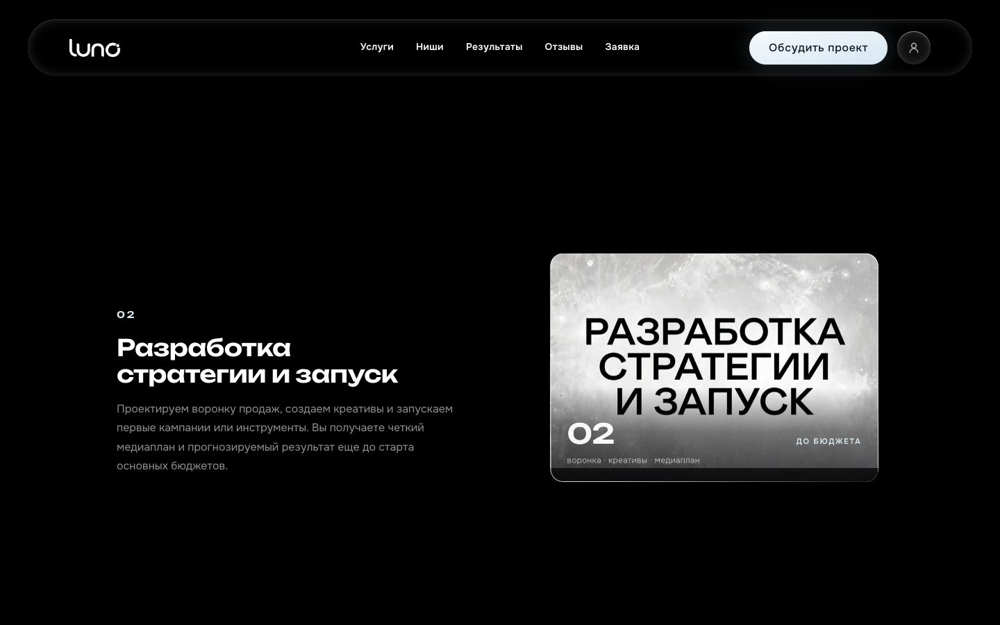
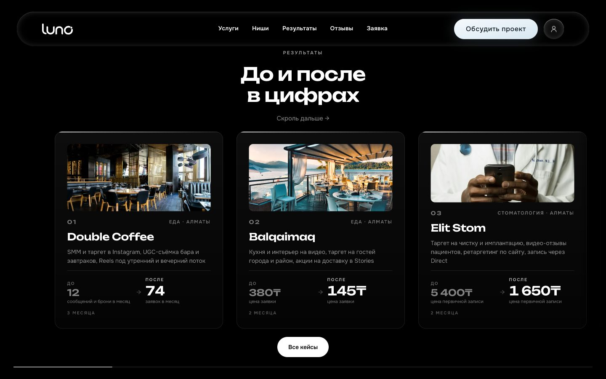
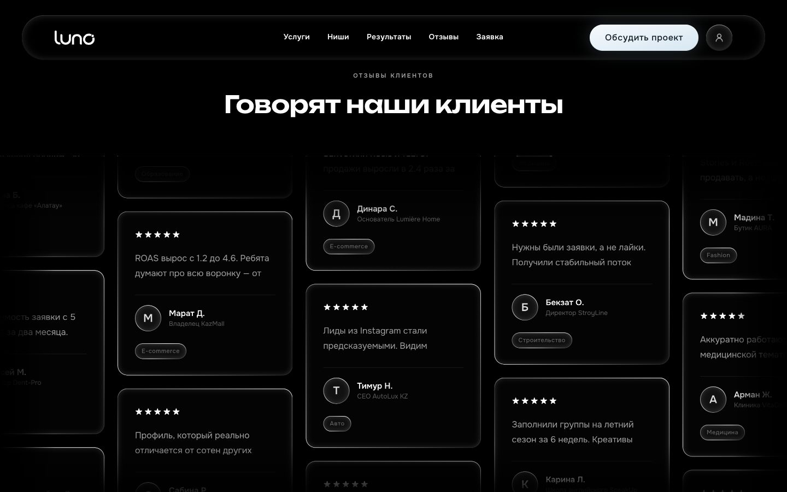
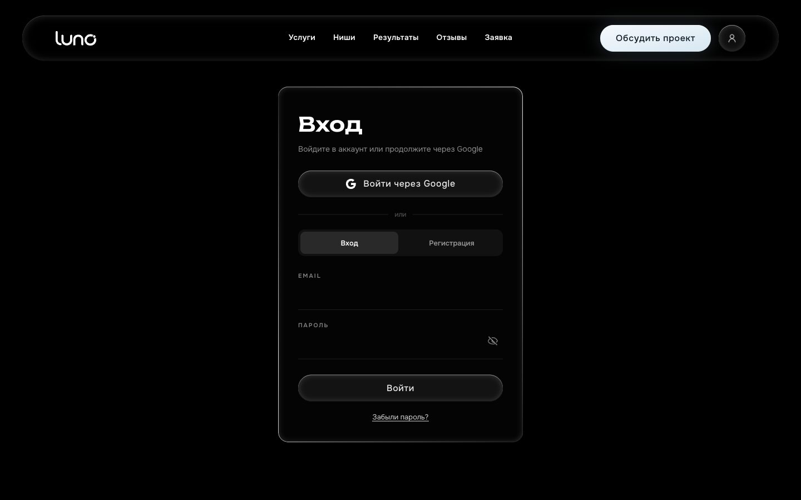
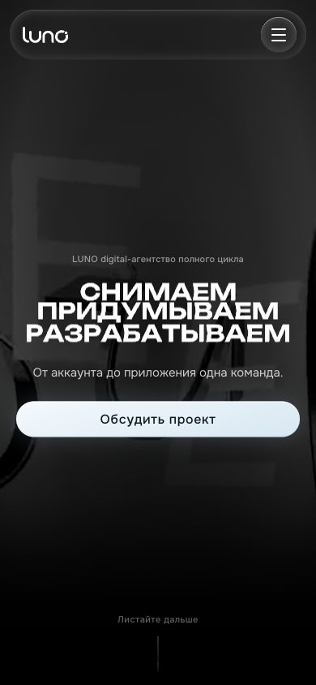

# LUNO: marketing site and client area for a digital agency

**Live demo:** https://luno-agency-nknpro.vercel.app

LUNO is a full-cycle digital agency in Almaty: film production, SMM, targeting, design, websites and apps. Their site has to sell that work, so it leads with motion instead of a stock template: a scroll-driven WebGPU headline, a refracting liquid-glass header, a 3D dome of client niches. All of it runs inside a frame budget on weak devices.

<p align="center">
  
</p>

The second half is a real product surface, not a mockup: email OTP registration, Google sign-in, password reset and a client dashboard with orders and support tickets, all backed by Postgres.

## The page, section by section

<table>
  <tr>
    <td width="50%"></td>
    <td width="50%"></td>
  </tr>
  <tr>
    <td></td>
    <td></td>
  </tr>
  <tr>
    <td></td>
    <td align="center"></td>
  </tr>
</table>

## What the visitor sees

| Section | Behaviour |
| --- | --- |
| Hero | WebGPU text scene driven by scroll position, video loop behind it, liquid-metal headline layer |
| Services | Stat cards that animate in as they enter the viewport |
| Process | Scroll-pinned flip plate through the five delivery steps |
| Niches | Dome gallery of client logos in 3D, rendered client-side only |
| Manifesto | Per-glyph blur reveal tied to scroll progress |
| Results | Horizontally pinned before/after rail with metric pairs |
| Reviews | Drag-and-throw carousel with gesture inertia |
| Contact | Form with validation and a WhatsApp fallback |

Routes: `/` landing, `/offer` and `/privacy` legal pages, `/login`, `/register`, `/forgot-password`, `/profile`.

## Motion engine

The heavy parts live in `lib/gl`, `lib/three`, `lib/scroll`, `lib/glass` and `lib/perf`.

- **WebGPU headline.** The destructive headline scene is built on `three/webgpu` with TSL nodes, so the extrusion and the shockwave are node-graph work rather than a hand-written shader string. It has a canvas fallback and a no-GPU path that leaves the text static.
- **Liquid glass header.** An SVG `feDisplacementMap` pipeline with refraction maps derived from Snell's law, so the header bends the page behind it instead of faking a blur. See `components/liquid-glass-v2` and `lib/glass`.
- **One scroll authority.** `lib/scroll/scrollTriggerSync.ts` gives every GSAP ScrollTrigger a single shared ticker, which removes duplicate layout reads when several pinned sections are mounted at once. Lenis drives the smoothing; `page-hash-scroll.tsx` keeps anchor links honest with the virtual scroll.
- **Lazy by section.** Every section below the fold is a `dynamic()` import, and the dome gallery mounts with `ssr: false`, so the first paint is HTML plus one video poster.

## Performance budget

Motion that a phone cannot afford is measured, not assumed.

- `lib/perf/deviceTier.ts` scores the device from GPU renderer string, hardware concurrency and memory, and returns a tier with `maxFps` and `maxLiveGlassFilters`.
- `lib/glass/glassCompositorWatchdog.ts` samples the compositor. A frame that lands later than 22 ms (about 45 fps) counts as late; sustained lateness calls `downgradePerfBudget()` and the page drops effects it cannot hold.
- CSS is scoped per component through 23 CSS modules, `next.config.ts` turns on AVIF/WebP optimization, strips `framer-motion` barrel re-exports, transpiles the shader packages and removes `console` calls in production builds.

## Auth and client area

Documented in detail in [`docs/AUTH.md`](docs/AUTH.md). In short:

- Registration is email, then a 6-digit code (15-minute TTL, stored as a SHA-256 digest), then name and password. Passwords are bcrypt with 12 rounds.
- Sessions are HS256 JWTs in an httpOnly `luno_session` cookie, 30 days, with `jti` bound to a row in `sessions` so logout can revoke server-side. Capped at 10 concurrent sessions per account.
- Google sign-in uses a signed OAuth state, so a forged callback is rejected before any token exchange.
- Rate limits for code send, verify and login live in the `auth_rate_limits` table rather than in process memory, and expired codes, sessions and limit rows are purged on auth requests instead of on a cron.
- Resetting a password revokes every other session for that account.

The demo deployment has no database attached, so the marketing site, legal pages and the auth forms render, while the flows that need storage return an error. Point `DATABASE_URL` at Postgres with `lib/db/schema.sql` applied to exercise `/login`, `/register` and `/profile`.

## Stack and size

Next.js 16 App Router, React 19, TypeScript, Tailwind CSS 4, GSAP with ScrollTrigger, Lenis, three.js including `three/webgpu`, Framer Motion, Postgres through `pg`, `jose` for tokens, `bcryptjs`, `nodemailer`.

| 23.2k | 51 | 23 | 14 | 8 |
| --- | --- | --- | --- | --- |
| lines of TS/TSX in `app`, `components`, `lib` | components and pages | CSS modules | API routes | Postgres tables |

## Run it

```bash
npm install
npm run dev
```

Open http://localhost:3000. No environment variables are required for the public site.

To enable accounts and the dashboard:

```bash
createdb luno
export DATABASE_URL=postgresql://localhost:5432/luno
export AUTH_SECRET=$(openssl rand -base64 48)
export APP_URL=http://localhost:3000
psql "$DATABASE_URL" -f lib/db/schema.sql
```

Copy `.env.example` to `.env.local` for the full list. Google OAuth and SMTP stay optional until you need those specific flows.

## Layout

```
app/          routes, api/ handlers, layouts
components/   sections, glass-ui, auth and profile surfaces
lib/auth/     OTP, Google OAuth, sessions, rate limits, maintenance
lib/db/       pool and schema.sql
lib/perf/     device tiering
lib/glass/    liquid glass observers, compositor watchdog
lib/gl/ lib/three/ lib/scroll/   WebGL/WebGPU scenes and scroll plumbing
vendor/       third-party shader sources, credited in components/footer/LICENSE-vendor.md
docs/         AUTH.md
```

`vendor/` is excluded from deployments through `.vercelignore` and holds upstream shader code with its own licence notes.

## Коротко по-русски

Сайт digital-агентства LUNO (Алматы) на Next.js 16 и Tailwind 4. Верх страницы держится на движении: заголовок на WebGPU и TSL-нодах, стеклянная шапка с реальным преломлением по закону Снелла, 3D-купол ниш, pinned-секции процесса и результатов. Всё это в рамках бюджета кадров: устройство получает тиер по GPU, ядрам и памяти, watchdog ловит кадры длиннее 22 мс и включает деградацию. Вторая половина это продукт: регистрация по email-коду, вход через Google, сброс пароля и кабинет клиента с заявками и задачами на Postgres. Демка без базы, поэтому формы отдаются, а записи в базе падают в ошибку.

## Rights

© 2026 Nikita Koreshkov. The code is published as a portfolio piece. The LUNO name, logo, copy and client materials belong to their owner, all rights reserved.
